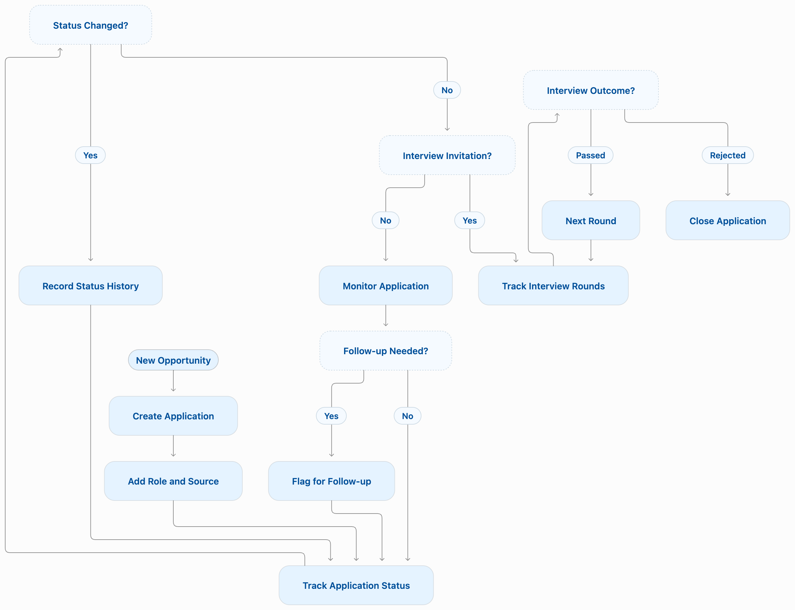
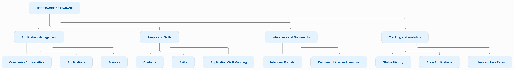

# Internship & Job Application Tracker

A SQLite database for organizing internship, full-time, and Master's programme applications. Built as the final project for **CS50's Introduction to Databases with SQL**.

It is tailored to a final-year ECE student applying to jobs and postgraduate programmes in Ireland, but its normalized design works for any personal application search.

## Features

- Track companies or universities, roles/programmes, application sources, and current status.
- Store recruiters, alumni, hiring managers, and admissions contacts.
- Link applications to required skills and relevant contacts through many-to-many junction tables.
- Record interview rounds, dates, notes, and outcomes.
- Store links to versioned resumes, cover letters, and statements of purpose.
- Automatically audit every genuine application-status change with a SQLite trigger.
- Find active applications needing follow-up after 14 days.
- Compare pass rates for completed interview types.
## Application Lifecycle



## Database design

`applications` is the central table. Supporting tables avoid repeated data: a skill or contact can be associated with many applications, while each interview, document, and audit record belongs to one application.




## Project structure

```text
.
├── README.md
└── outputs/
    ├── DESIGN.md       # Technical design and project limitations
    ├── schema.sql      # Tables, constraints, views, indexes, and trigger
    ├── seed.sql        # Realistic demo data
    └── queries.sql     # Annotated example SQL queries
```

## Quick start

The only requirement is [SQLite](https://www.sqlite.org/).

```bash
git clone https://github.com/ajala-02/job-application-tracker.git
cd job-application-tracker/outputs
sqlite3 tracker.db
```

At the `sqlite>` prompt, create the schema and load the sample records:

```sql
.read schema.sql
.read seed.sql
.headers on
.mode column
```

Try the two reporting views:

```sql
SELECT * FROM stale_applications;
SELECT * FROM interview_pass_rates;
```

## Key implementation details

### Status audit trigger

`log_status_change` runs after a real change to `applications.status`. It refreshes `current_stage_updated_at` and writes the old status, new status, and timestamp to `status_history`.

```sql
UPDATE applications
SET status = 'interviewing'
WHERE role_title = 'Graduate Software Engineer';

SELECT * FROM status_history ORDER BY id DESC LIMIT 3;
```

### Views

- `stale_applications` lists non-closed applications with no status update in 14 or more days.
- `interview_pass_rates` reports the pass percentage for each completed interview type, excluding pending interviews.

### Indexes

The project indexes `applications(status)`, `applications(company_id)`, and `interviews(application_id)` because dashboards and application-detail pages commonly filter on those columns.

## Limitations and future work

This is a single-user local SQLite application. It does not currently support accounts, shared editing, salary or compensation tracking, negotiation workflows, reminders, or document-file storage. Possible future extensions include an offer table, deadline reminders, and a web dashboard.

## Video overview

[Watch the three-minute project overview](https://youtu.be/7qt5hve1zH8)

## Author

Ajala Nalawade
